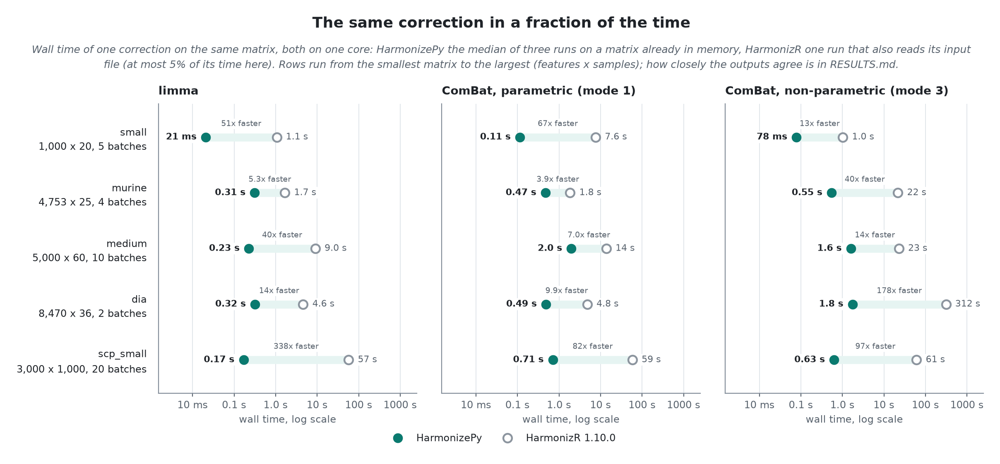
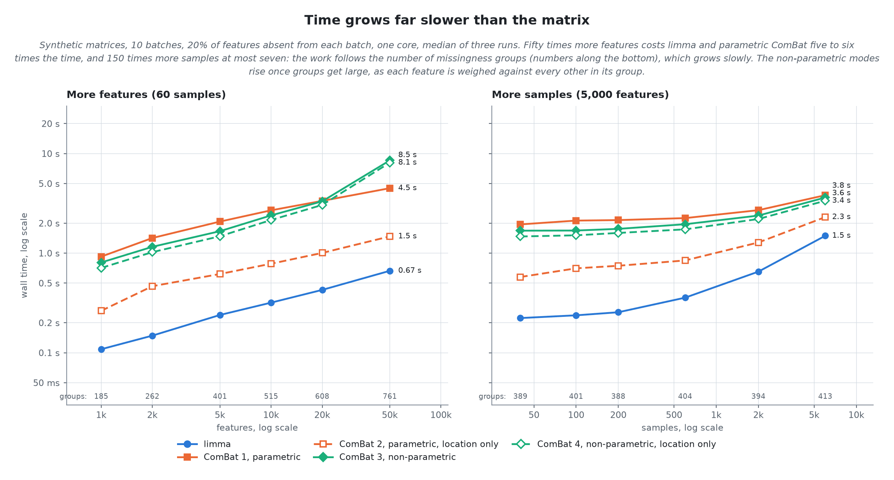
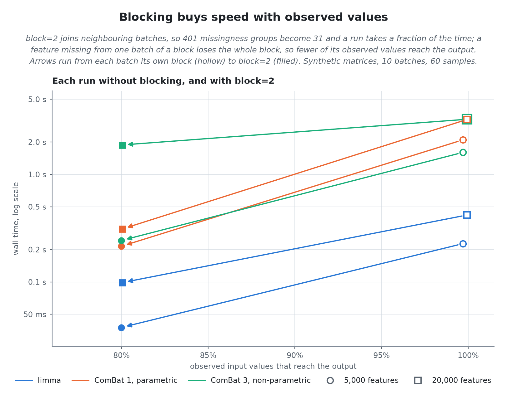
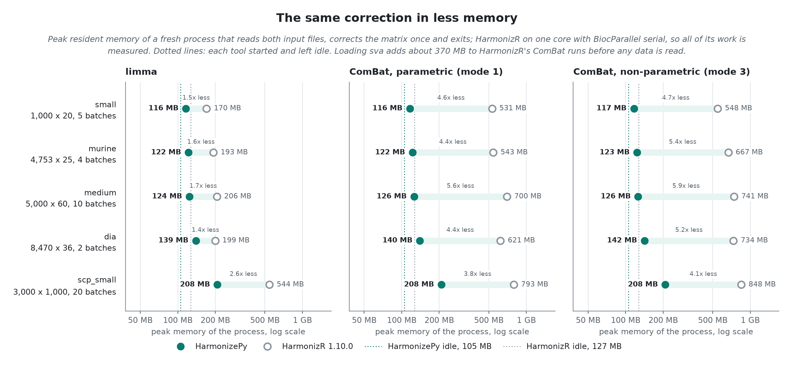
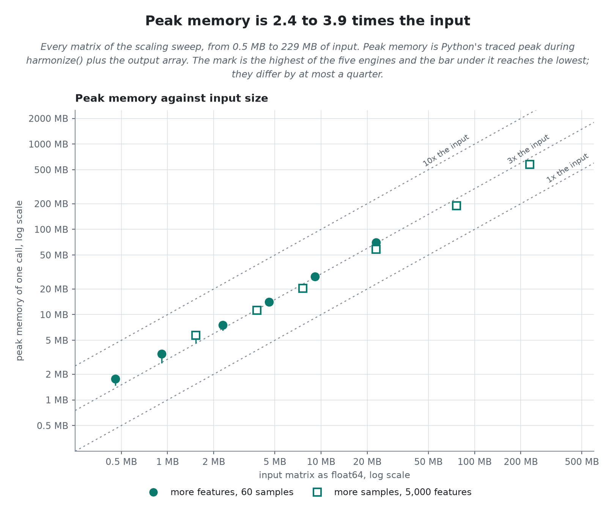
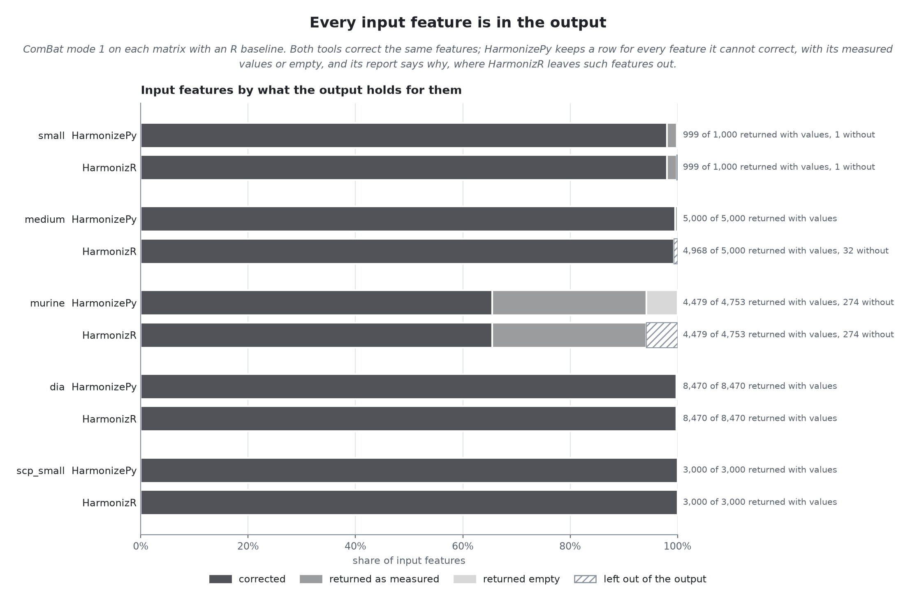

# Benchmark Results

Benchmark summary for HarmonizePy 0.4.0: runtime and memory of the Python implementation, and concordance with HarmonizR 1.10.0 on the datasets where an R baseline is practical. The raw outputs of a run go to `benchmarks/results/`, which is not tracked; rerun the commands below to reproduce them on your own hardware.

## How to reproduce

The summary combines five runs. Each writes a fixed file under `benchmarks/results/`, and the figures command reads those files, so running the commands in order rebuilds every number and figure on this page.

```bash
export OMP_NUM_THREADS=1 OPENBLAS_NUM_THREADS=1

# HarmonizR baselines, one R core (cached; the parity pass attaches them)
uv run python -m benchmarks.bench cache-r --datasets small medium dia murine scp_small --cores 1

# Parity pass: Python against the cached R baselines
uv run python -m benchmarks.bench run \
  --datasets small medium dia murine scp_small \
  --with-r --with-r-cores 1 \
  --n-reps 3 \
  --out benchmarks/results/benchmark_r_parity.json \
  --md benchmarks/results/benchmark_r_parity.md

# Python-only pass on the two largest datasets
uv run python -m benchmarks.bench run \
  --datasets large scp_large \
  --n-reps 1 \
  --no-warmup \
  --out benchmarks/results/benchmark_python_extremes.json \
  --md benchmarks/results/benchmark_python_extremes.md

# Peak memory of both tools, each run in a fresh process -> memory_peak.json
uv run python -m benchmarks.memory_peak

# Scaling and blocking sweeps on synthetic matrices -> scaling.json
uv run python -m benchmarks.scaling

# What each tool returns per feature, from the parity pass -> outcomes.json
uv run python -m benchmarks.outcomes

# Every figure, into benchmarks/figures/ and wiki/assets/
uv run --group figures python -m benchmarks.figures
```

- The R baselines and the peak-memory runs need R with the packages pinned by `renv.lock`; `memory_peak` keeps the measurements already in its file and adds the missing ones.
- The Python-only pass uses one timed repetition without warmup, so its memory stability is reported as `INSUFFICIENT-DATA` by construction.
- Python runs on one thread, with BLAS limited to one thread by the environment variables above.
- `benchmarks.figures` skips a figure whose result file is missing; `--help` lists the paths it reads.

## Datasets

| Dataset     | Kind                   | Features | Samples | Batches | Missing | Size     | R baseline |
| ----------- | ---------------------- | -------- | ------- | ------- | ------- | -------- | ---------- |
| `small`     | Synthetic bulk         | 1000     | 20      | 5       | 30%     | 261 KB   | yes        |
| `medium`    | Synthetic bulk         | 5000     | 60      | 10      | 20%     | 4.3 MB   | yes        |
| `large`     | Synthetic bulk         | 10000    | 100     | 20      | 5%      | 16.7 MB  | no         |
| `murine`    | Real (medulloblastoma) | 4753     | 25      | 4       | natural | 808 KB   | yes        |
| `dia`       | Real (DIA proteomics)  | 8470     | 36      | 2       | natural | 4.8 MB   | yes        |
| `scp_small` | Synthetic SCP          | 3000     | 1000    | 20      | 50%     | 24.9 MB  | yes        |
| `scp_large` | Synthetic SCP          | 5000     | 10000   | 100     | 60%     | 375.5 MB | no         |

- Missingness in the synthetic sets removes whole batches per feature (bulk) or follows a random detection profile per feature (SCP).
- `dia` has two batches, so it runs without blocking only; `block=2` would form a single block.
- `large` and `scp_large` have no R baseline; they show how the Python implementation scales.

## Environment

- A 16-core x86-64 desktop running Linux, shared with other work while the runs took place.
- Python 3.13.15, NumPy 2.5.4 with scipy-openblas 0.3.34, pandas 3.1.0, HarmonizePy 0.4.0.
- R baselines: R 4.6.2, HarmonizR 1.10.0, sva 3.60.0, limma 3.68.5, Bioconductor 3.23, as pinned by `renv.lock`, one core, on the same machine.
- The R baselines were cached immediately before the Python passes, so both columns saw the same load.

HarmonizR runs on one core because its `doParallel` fork workers inherit the multi-threaded OpenBLAS pool and compete with its threads, so a multi-core timing would measure that interaction rather than the correction. Its per-scenario limit is 1800 s (`benchmarks/config.yaml`); `dia` ComBat 3 and 4 take about 310 s each.

## Runtime

<p align="center">
  <picture>
    <source media="(prefers-color-scheme: dark)" srcset="figures/01-speed-dark.png">
    <source media="(prefers-color-scheme: light)" srcset="figures/01-speed-light.png">
    
  </picture>
</p>

Wall time of `harmonize()` in seconds: the median of three repetitions for Python, on a matrix already in memory, and one run for R, whose time also includes reading its input file (at most 5% of its time on these datasets).

| Scenario                   | Python (s) | R (s) |
| -------------------------- | ---------- | ----- |
| `small` limma              | 0.021      | 1.06  |
| `small` ComBat 1           | 0.114      | 7.61  |
| `medium` ComBat 1          | 1.98       | 13.8  |
| `medium` ComBat 1, block 2 | 0.206      | 5.05  |
| `medium` ComBat 3, block 2 | 0.245      | 22.3  |
| `murine` ComBat 1          | 0.471      | 1.85  |
| `murine` ComBat 4, block 2 | 0.357      | 22.9  |
| `dia` ComBat 1             | 0.485      | 4.79  |
| `dia` ComBat 3             | 1.75       | 312   |
| `scp_small` limma          | 0.169      | 57.1  |
| `scp_small` ComBat 1       | 0.709      | 58.5  |

Python-only pass, one repetition:

| Scenario                  | Python (s) |
| ------------------------- | ---------- |
| `large` limma             | 0.431      |
| `large` ComBat 1          | 3.91       |
| `large` ComBat 2          | 1.11       |
| `large` ComBat 2, block 2 | 0.542      |
| `large` ComBat 3          | 6.96       |
| `large` ComBat 3, block 2 | 4.85       |
| `scp_large` limma         | 2.17       |
| `scp_large` ComBat 1      | 4.17       |
| `scp_large` ComBat 3      | 4.74       |

- Python was faster than single-core HarmonizR in every parity scenario, from about 4 times (`murine` ComBat 1) to about 340 times (`scp_small` limma).
- Blocking cuts the number of groups: on `medium` ComBat 1 it takes the run from 1.98 s to 0.206 s, and on `large` ComBat 2 from 1.11 s to 0.542 s.
- The non-parametric modes (3 and 4) compare each feature with every other feature in its group, so their cost grows with the square of the group size; they are the slowest modes on `dia`, `murine`, and `large`.

## Scaling and blocking

The sweeps in `scaling.json` correct synthetic matrices with ten batches, each feature absent from 20% of the batches, on one core, timing the median of three runs.

<p align="center">
  <picture>
    <source media="(prefers-color-scheme: dark)" srcset="figures/03-scaling-dark.png">
    <source media="(prefers-color-scheme: light)" srcset="figures/03-scaling-light.png">
    
  </picture>
</p>

| Matrix         | Groups | limma (s) | ComBat 1 (s) | ComBat 3 (s) |
| -------------- | -----: | --------: | -----------: | -----------: |
| 1,000 x 60     |    185 |     0.109 |        0.924 |        0.807 |
| 50,000 x 60    |    761 |     0.665 |         4.49 |         8.55 |
| 5,000 x 40     |    389 |     0.223 |         1.95 |         1.68 |
| 5,000 x 6,000  |    413 |      1.50 |         3.82 |         3.62 |

- The work follows the number of missingness groups, which grows far slower than the matrix: 50 times more features cost limma 6.1 times and ComBat 1 4.9 times the time, and 150 times more samples cost at most 6.7 times.
- The non-parametric modes compare each feature with every other feature of its group, so they overtake the parametric modes once groups get large (50,000 features).

<p align="center">
  <picture>
    <source media="(prefers-color-scheme: dark)" srcset="figures/05-blocking-dark.png">
    <source media="(prefers-color-scheme: light)" srcset="figures/05-blocking-light.png">
    
  </picture>
</p>

- `block=2` joins neighbouring batches, so the 401 groups of the 5,000-feature matrix become 31; runs take 4 to 10 times less time, except ComBat 3 at 20,000 features (1.7 times less).
- The price is observed values: a feature missing from one batch of a block loses the whole block, so about 80% of the observed values reach the output instead of 99.7 to 99.9%.
- Without blocking, ComBat 1 and ComBat 3 take the same time at 20,000 features; the nested squares mark that point.

## Memory

### Against HarmonizR

Peak resident memory of a fresh process that reads the data and description files, corrects the matrix once, and exits (`memory_peak.json`). This is the memory the operating system had to give each tool, interpreter and libraries included. HarmonizR runs on one core with BiocParallel set to serial, so all of its work stays in the measured process.

<p align="center">
  <picture>
    <source media="(prefers-color-scheme: dark)" srcset="figures/02-memory-dark.png">
    <source media="(prefers-color-scheme: light)" srcset="figures/02-memory-light.png">
    
  </picture>
</p>

| Dataset     | Python (MB) | R limma (MB) | R ComBat 1 (MB) | R ComBat 3 (MB) |
| ----------- | ----------: | -----------: | --------------: | --------------: |
| idle        |         105 |          127 |             127 |             127 |
| `small`     |   116 - 117 |          170 |             531 |             548 |
| `murine`    |   122 - 123 |          193 |             543 |             667 |
| `medium`    |   124 - 126 |          206 |             700 |             741 |
| `dia`       |   139 - 142 |          199 |             621 |             734 |
| `scp_small` |         208 |          544 |             793 |             848 |

- Python's column covers its three engines, which differ by at most 3 MB. Idle is each tool started, with its package loaded, and stopped.
- HarmonizePy needs 1.4 to 2.6 times less memory than HarmonizR with limma, and 3.8 to 5.9 times less with ComBat.
- Most of HarmonizR's ComBat peak is fixed: loading sva and its dependencies adds about 370 MB before any data is read.

### Against input size

<p align="center">
  <picture>
    <source media="(prefers-color-scheme: dark)" srcset="figures/04-memory-scaling-dark.png">
    <source media="(prefers-color-scheme: light)" srcset="figures/04-memory-scaling-light.png">
    
  </picture>
</p>

Over the scaling sweep, the traced peak of one call stays between 2.4 and 3.9 times the input matrix as float64, from 0.5 MB to 229 MB of input; the five engines differ by at most a quarter.

### Per call, in the parity pass

Peak Python heap (tracemalloc) of one `harmonize()` call, against the R heap reported by `gc()`.

| Dataset     | Python min (MB) | Python max (MB) | R min (MB) | R max (MB) |
| ----------- | --------------- | --------------- | ---------- | ---------- |
| `small`     | 0.7             | 1.4             | 69         | 355        |
| `medium`    | 8.5             | 9.9             | 358        | 372        |
| `murine`    | 4.5             | 6.3             | 370        | 371        |
| `dia`       | 19.4            | 21.2            | 364        | 372        |
| `scp_small` | 70.7            | 73.6            | 393        | 393        |
| `large`     | 33.8            | 46.3            | --         | --         |
| `scp_large` | 1171            | 1192            | --         | --         |

- Minimum and maximum over the scenarios of each dataset; `--` means no R baseline.
- Python's retained RSS stayed flat across repetitions in every parity scenario.
- R runs every scenario in one process, so later R scenarios can reuse memory allocated by earlier ones.

## Concordance with HarmonizR

<p align="center">
  <picture>
    <source media="(prefers-color-scheme: dark)" srcset="figures/06-outcomes-dark.png">
    <source media="(prefers-color-scheme: light)" srcset="figures/06-outcomes-light.png">
    
  </picture>
</p>

Both tools correct the same features; HarmonizePy keeps a row for every feature it cannot correct, with its measured values or empty, where HarmonizR leaves such features out (`outcomes.json`, ComBat mode 1).

Python against R on the features both outputs contain. Relative difference is `|py - r| / |r|` over cells where both have a value. "Python only" counts the features HarmonizePy returns and HarmonizR does not.

| Scenario group                             | Max relative difference | Missing cells match | Python only  |
| ------------------------------------------ | ----------------------- | ------------------- | ------------ |
| `small`, all modes                         | 6e-06                   | yes                 | 1            |
| `small`, block 2                           | 4e-06                   | yes                 | 69           |
| `dia`, all modes                           | 5e-14                   | yes                 | 0            |
| `scp_small` limma, ComBat 1 and 2          | 7e-06                   | yes                 | 0            |
| `scp_small` ComBat 3 and 4                 | 5e-15                   | no                  | 0            |
| `murine` limma, ComBat 1 and 3             | 3e-04                   | yes                 | 274          |
| `murine` ComBat 2 and 4                    | 7e-09                   | no                  | 229          |
| `murine` block 2                           | 6e-06                   | 1, 3 yes; 2, 4 no   | 2222 to 2357 |
| `medium` block 2, with and without sorting | 7e-06                   | yes                 | 38           |
| `medium` without blocking, all modes       | 7.7                     | no                  | 32           |

- No feature appears only in HarmonizR's output in any scenario.
- ComBat mode 1 differs by up to 3e-04 relative (`murine`); its parametric solver stops at a convergence tolerance. The other modes differ by at most 7e-09.
- Python-only features are the ones HarmonizR drops: features alone in their group, features with no usable batch, and, with unique removal, features it empties because no target exists. HarmonizePy keeps them, raw or missing, and its correction report names each.
- `murine` ComBat 2 and 4: HarmonizR returns 870 features entirely missing although the input has values for them; HarmonizePy corrects them. Of the 229 features HarmonizR drops, 221 have values in a single batch and are kept raw, and 8 are empty rows.
- `medium` without blocking: the differences come from unique removal, where the two rules take features in a different order. HarmonizePy takes the longest affiliations first and HarmonizR takes rows in input order, so some features move to a different target, which also changes the groups they join. With limma, 49 of the 4968 shared features differ by more than 1e-4 relative or in their missing cells: 35 are features HarmonizePy cropped, 10 are in groups whose members those moves change, and 4 are features HarmonizePy keeps raw as alone in their pattern. With blocking there are fewer patterns and the outputs agree. The parity document describes the rule.
- `scp_small` ComBat 3 and 4: HarmonizR returns 1256 of the 3000 features entirely missing, although the input has values for them; HarmonizePy corrects them. On every cell both outputs have, the values agree to rounding.
