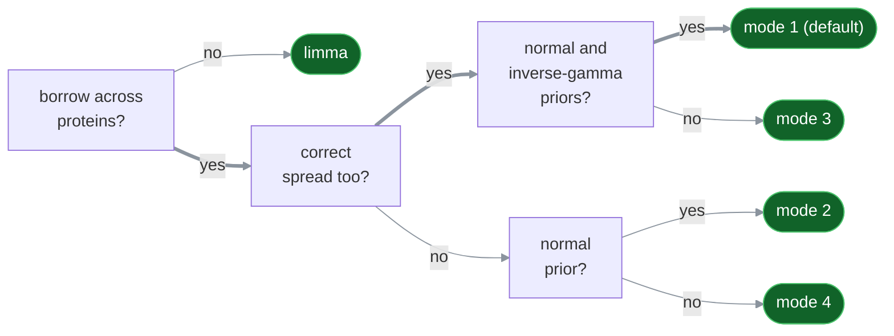

# Choosing an engine

Which engine fits depends on two questions about the data, should a protein's batch effect be estimated partly from the other proteins, and does a batch change the spread of a protein or only its level, and on one about assumptions: may the batch effects across proteins be taken to follow a known distribution? ComBat and limma answer them differently, and ComBat's four modes cover the combinations.



<p align="center"><sub><b>Figure 1.</b> Three questions, asked in order, pick an engine; modes are ComBat modes, and the thick line leads to the default. Borrowing means estimating each protein's batch effect partly from the other proteins. The last question asks whether the batch shifts may be taken as normal, and the batch spreads as inverse-gamma; a no gives the non-parametric modes. The sections below say what each answer trades away.</sub></p>

| Engine                  | Borrows across features | Corrects scale | Prior          |
| ----------------------- | ----------------------- | -------------- | -------------- |
| ComBat mode 1 (default) | yes                     | yes            | parametric     |
| ComBat mode 2           | yes                     | no             | parametric     |
| ComBat mode 3           | yes                     | yes            | non-parametric |
| ComBat mode 4           | yes                     | no             | non-parametric |
| limma                   | no                      | no             | none           |

## Borrowing or not

ComBat estimates each protein's batch effects partly from the other proteins in its group (see [ComBat](ComBat)). With small batches this steadies estimates that would otherwise follow the noise of a few samples ([Johnson et al. 2007](References#johnson-et-al-2007)). It also means the result for one protein depends on which others share its group, and a group needs at least two features.

limma fits each protein alone (see [limma](limma)). A protein's correction depends only on its own values, and the batch means of every corrected protein end exactly equal. With few samples per batch, those means carry more noise into the correction.

## Level only, or level and spread

Modes 1 and 3 also correct each batch's spread; modes 2 and 4, and limma, leave it as it was. Location-only correction is the choice when the differences in spread between batches are to be kept, for example because they were already made comparable before correction. Location-only modes need one value per batch instead of two (`needed_values` 1), so a feature with a single value in a batch can count there. It can still be left raw, for example when it has no spread within batches.

## Parametric or non-parametric

The parametric prior assumes the batch effects across proteins follow a normal and an inverse-gamma distribution. The non-parametric prior makes no such assumption and weights the other proteins' estimates directly. It costs more: its work grows with the square of the number of features in a group, where the parametric prior grows in proportion. No measurement here shows one correcting better than the other on real data.

## Checking a choice

No measurement here ranks the engines or modes in general, and the tests compare against R, not against a known truth (see [Limits](Limits)). Some checks on a given matrix:

- The [correction report](Correction-Report): how many features each setting corrects, leaves raw or empties.
- Batch grouping before and after, for example in a PCA of the corrected features. A batch grouping that has reversed, rather than disappeared, points to over-correction; comparing with limma, which does not borrow, or with mode 2, which leaves the spread alone, can show whether the scale correction or the shrinkage is the cause.
- A known biological difference that is balanced across batches should survive correction.

## Setting it

```python
harmonize(data, batch)                      # ComBat mode 1
harmonize(data, batch, combat_mode=3)       # ComBat mode 3
harmonize(data, batch, algorithm="limma")   # limma
```

On the command line: `--combat-mode 3`, `--algorithm limma`. With limma, `combat_mode` must still be a valid mode (1 to 4) but has no effect.

## Related pages

- [ComBat](ComBat): the model, the priors and the features set aside.
- [limma](limma): the linear model and its edges.
- [Pipeline](Pipeline): both engines run once per affiliation group.
