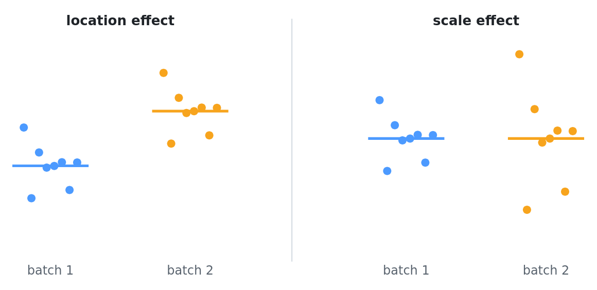
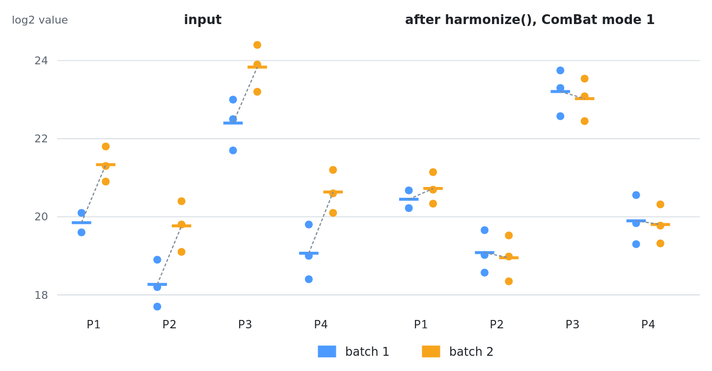

# Batch effects

Samples measured on different days, plexes, columns, instruments or sites pick up differences that have nothing to do with their biology. When those differences move many features the same way for every sample processed together, they are a batch effect, and they can be larger than the biology a study is looking for ([Leek et al. 2010](References#leek-et-al-2010)).

## What a batch is to HarmonizePy

To HarmonizePy a batch is a whole-number label on each sample, read from the `batch` column of the batch description (see [Input format](Input-Format)). Samples with the same label are assumed to share one technical condition. Nothing else about a sample, such as its condition, subject or tissue, is read.

In proteomics a batch is usually an LC-MS acquisition series, a TMT plex, an instrument, a column or a processing day ([Cuklina et al. 2021](References#cuklina-et-al-2021)). The tool cannot tell whether one label merges two technical sources or two labels split one, so the batch labels are a design decision made before the run, and the correction is only as good as they are.

## What the effect looks like in a matrix

Take one protein measured in two batches of three samples, on a log2 scale:

```text
           s1     s2     s3  |  s4     s5     s6
P2       18.20  18.90  17.70 | 19.80  20.40  19.10
batch       1      1      1  |   2      2      2
mean          18.27          |       19.77
```

Batch 2 reads about 1.5 units higher. On a log2 scale that is a 2.8-fold difference in intensity, applied to every sample of the batch. A batch can also change the spread of a feature: one run might be noisier than another. The engines model these, per feature and per batch:

- a location effect, a shift added to every value of the feature in that batch;
- a scale effect, a factor on the feature's spread in that batch.

<p align="center">
  <picture>
    <source media="(prefers-color-scheme: dark)" srcset="assets/location-scale-dark.png">
    <source media="(prefers-color-scheme: light)" srcset="assets/location-scale-light.png">
    
  </picture>
</p>
<p align="center"><sub><b>Figure 1.</b> The two kinds of batch effect the engines model. A location effect moves a whole batch; a scale effect leaves the batch mean in place and widens or narrows its spread. Simulated values.</sub></p>

ComBat in modes 1 and 3 removes both. ComBat in modes 2 and 4, and limma, remove the location effect only (see [Choosing an engine](Algorithms)).

## What correction does to it

Here are four proteins from the [Quick start](Quick-Start) example, before and after `harmonize()` with the default ComBat mode 1:

<p align="center">
  <picture>
    <source media="(prefers-color-scheme: dark)" srcset="assets/batch-shift-dark.png">
    <source media="(prefers-color-scheme: light)" srcset="assets/batch-shift-light.png">
    
  </picture>
</p>
<p align="center"><sub><b>Figure 2.</b> Each dot is a sample and each bar a batch mean. Before correction every protein's batch 2 mean sits about 1.5 above its batch 1 mean; after it, the two means are within 0.3 of each other, and P3 is still near 23 while P2 is near 19.</sub></p>

The batch means, in numbers:

```text
before                       after
         batch 1  batch 2             batch 1  batch 2
P1         19.85    21.33    P1         20.45    20.72
P2         18.27    19.77    P2         19.08    18.95
P3         22.40    23.83    P3         23.21    23.02
P4         19.07    20.63    P4         19.90    19.80
```

The gap of about 1.5 between the batches shrinks to between 0.1 and 0.3, and each protein keeps its own level: P3 stays near 23 and P2 near 19. ComBat does not make the batch means exactly equal. It estimates each protein's batch shift partly from the other proteins in its group, and that shrinkage leaves a small remainder (see [ComBat](ComBat)).

## Why the log scale matters

Both engines treat the location effect as something added. On raw intensities a batch effect is closer to a factor (the same run that reads 1000 as 1500 reads 100 as 150), and the spread of a feature grows with its level, so one additive shift and one spread per feature fit poorly ([Rocke and Durbin 2001](References#rocke-and-durbin-2001)). The log turns the factor into a shift. HarmonizePy does not transform the data itself, and warns when the values look untransformed (see [Input format](Input-Format#scale)).

## When the batch is also the biology

The batch estimate for a feature is computed from all samples in the batch. If one batch holds mostly treated samples and another mostly controls, the batch estimate mixes the treatment difference with the technical shift, so correction removes part of the treatment effect and leaves part of the technical shift.

> [!WARNING]
> HarmonizePy reads nothing about a sample beyond its name and batch label. It cannot be told which samples belong to which condition, so it cannot protect a condition that is unevenly spread over batches (see [Limits](Limits)). A design where every batch holds samples of every condition avoids the problem. A corrected matrix that looks clean in a PCA can still have lost the effect the study was designed to find, and batch correction on such a design can overstate the confidence of later tests ([Nygaard et al. 2016](References#nygaard-et-al-2016)).

## Related pages

- [Missing values](Missing-Values): why a protein can be absent from a whole batch, and what that does to correction.
- [ComBat](ComBat): how the location and scale effects are estimated and shrunk.
- [limma](limma): the location-only alternative with no sharing between features.
