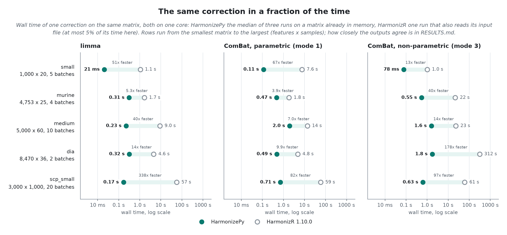
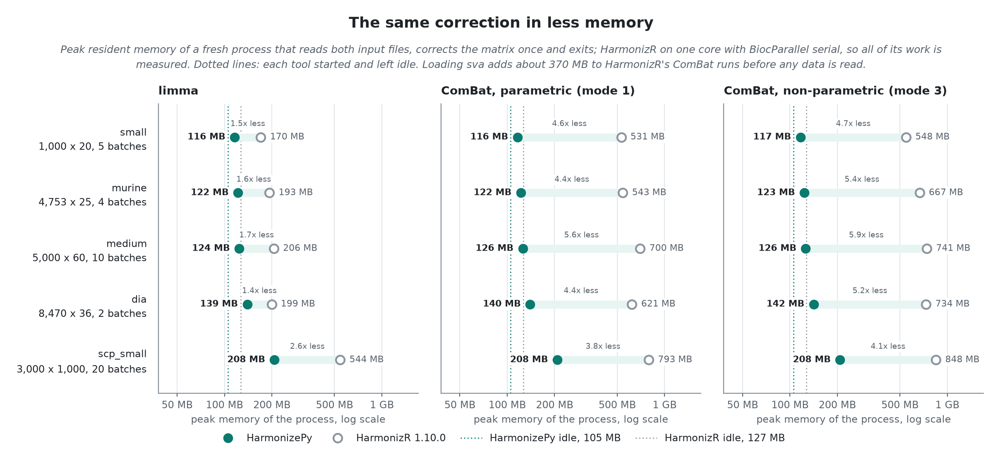
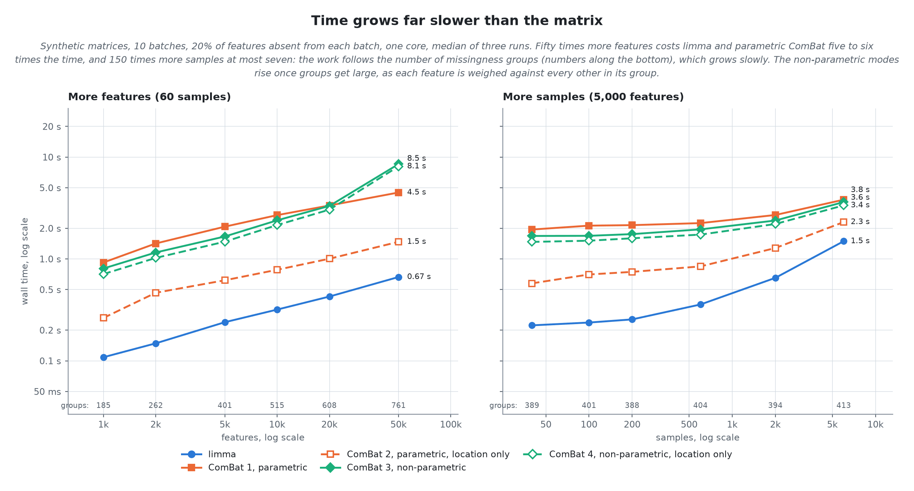
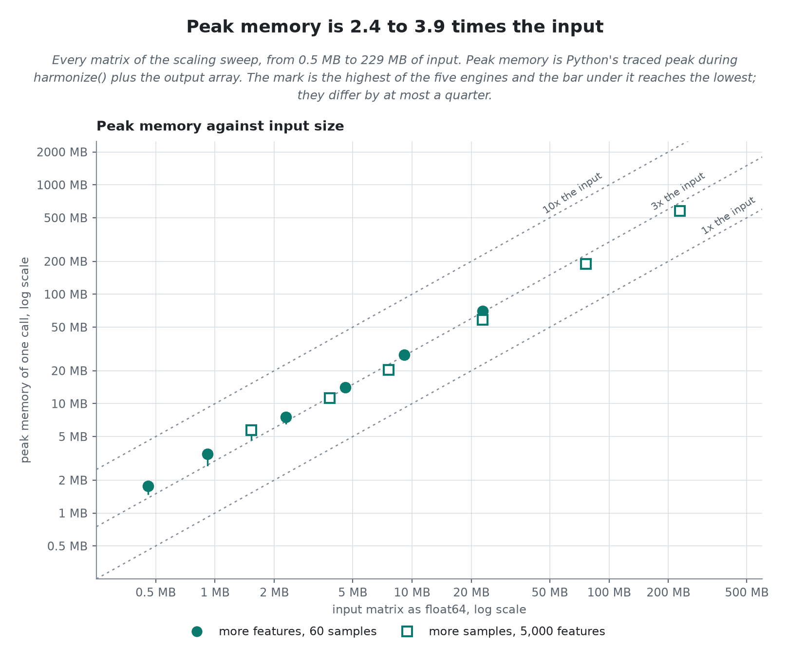
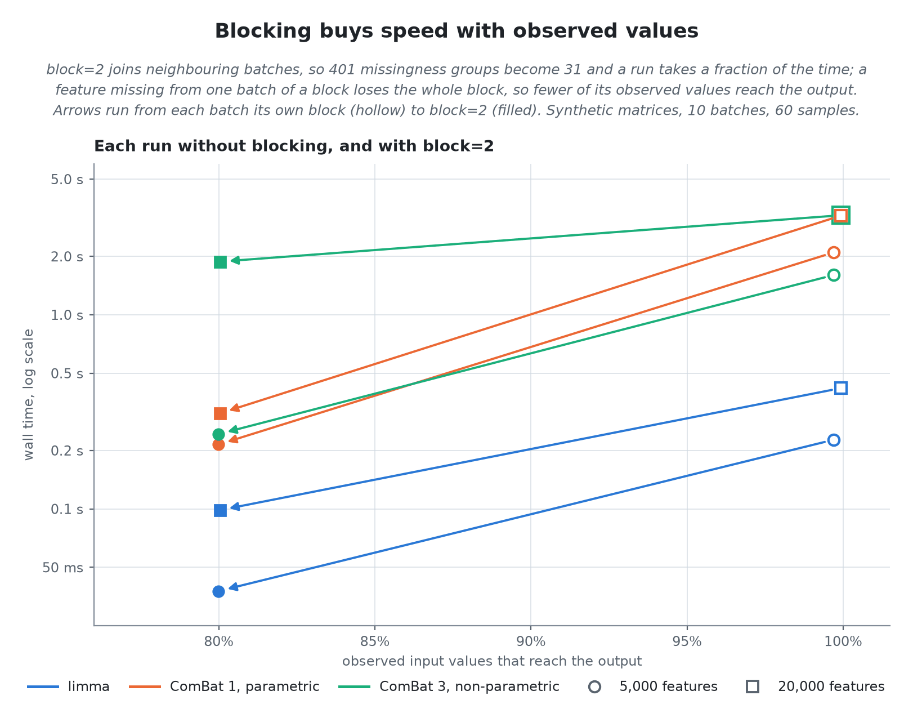
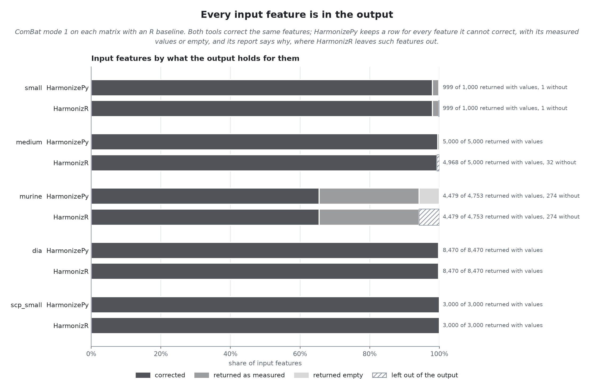

# Benchmarks

The benchmark suite measures how long `harmonize()` takes and how much memory it uses, and compares its output with single-core HarmonizR on matrices too large for the test fixtures. The latest results are in [`benchmarks/RESULTS.md`](https://github.com/LangeLab/HarmonizePy/blob/main/benchmarks/RESULTS.md) in the repository, measured at a stated version; this page describes what the suite runs and how to read and reproduce it.

<p align="center">
  <picture>
    <source media="(prefers-color-scheme: dark)" srcset="assets/benchmark-speed-dark.png">
    <source media="(prefers-color-scheme: light)" srcset="assets/benchmark-speed-light.png">
    
  </picture>
</p>
<p align="center"><sub><b>Figure 1.</b> Wall time of one correction on each matrix with an R baseline, both tools on one core. HarmonizR's time includes reading its input file, at most 5% of it here. <a href="https://github.com/LangeLab/HarmonizePy/blob/main/benchmarks/RESULTS.md#runtime">RESULTS.md</a> has every scenario.</sub></p>

<p align="center">
  <picture>
    <source media="(prefers-color-scheme: dark)" srcset="assets/benchmark-memory-dark.png">
    <source media="(prefers-color-scheme: light)" srcset="assets/benchmark-memory-light.png">
    
  </picture>
</p>
<p align="center"><sub><b>Figure 2.</b> Peak memory of a fresh process that reads both input files, corrects once and exits. Dotted lines mark each tool started and left idle; loading sva adds about 370 MB to HarmonizR's ComBat runs. <a href="https://github.com/LangeLab/HarmonizePy/blob/main/benchmarks/RESULTS.md#against-harmonizr">RESULTS.md</a> has the table.</sub></p>

## Datasets

| Dataset     | Kind                  | Features | Samples | Batches | R baseline |
| ----------- | --------------------- | -------- | ------- | ------- | ---------- |
| `small`     | synthetic bulk        | 1000     | 20      | 5       | yes        |
| `medium`    | synthetic bulk        | 5000     | 60      | 10      | yes        |
| `large`     | synthetic bulk        | 10000    | 100     | 20      | no         |
| `murine`    | real proteomics       | 4753     | 25      | 4       | yes        |
| `dia`       | real DIA proteomics   | 8470     | 36      | 2       | yes        |
| `scp_small` | synthetic single-cell | 3000     | 1000    | 20      | yes        |
| `scp_large` | synthetic single-cell | 5000     | 10000   | 100     | no         |

- The synthetic sets are generated by `benchmarks/datasets.py`: values from a normal distribution, one shift per batch shared by every feature, and missing values removed per feature and batch for the bulk sets, or by a random detection profile for the single-cell sets. They exercise the code at a given shape; they carry no biology and no scale effect, so they say nothing about how well a correction recovers either.
- `large` and `scp_large` run without R: they show how the Python implementation scales.
- `dia` has two batches, so it runs without blocking only.
- The two real matrices are not part of the repository; the suite reads them from `benchmarks/data/` when present.

## What is measured

- Wall time of one `harmonize()` call, median over repetitions, after a warm-up run in the R-backed pass.
- Memory within a run: the peak of Python allocations traced by `tracemalloc` during the call, plus the size of the result matrix.
- Memory against HarmonizR: the peak resident set of a fresh process per run (`ru_maxrss`), which reads the two input files, corrects once and exits. It counts everything the operating system gives the tool, interpreter and libraries included; a run that only loads each tool gives its idle cost. HarmonizR runs with BiocParallel set to serial, so all of its work stays in the measured process.
- Against HarmonizR: the largest relative difference, `|py - r| / |r|`, over cells both outputs have, and whether the missing cells sit in the same places.

HarmonizePy runs on one thread, with BLAS limited to one thread. HarmonizR runs with one R worker. R baselines are cached; `RESULTS.md` records them cached immediately before the Python passes, so both saw the same load. Absolute times on a shared machine still move from day to day; ratios measured in one batch compare. The Python heap and R's `gc()` heap measure different things and do not compare directly; the fresh-process peaks do.

## Scaling

A separate sweep corrects synthetic matrices with ten batches, each feature absent from 20% of them, growing either the features or the samples.

<p align="center">
  <picture>
    <source media="(prefers-color-scheme: dark)" srcset="assets/benchmark-scaling-dark.png">
    <source media="(prefers-color-scheme: light)" srcset="assets/benchmark-scaling-light.png">
    
  </picture>
</p>
<p align="center"><sub><b>Figure 3.</b> Time follows the number of missingness groups, printed along the bottom, which grows far slower than the matrix. The non-parametric modes compare each feature with every other in its group, so they rise once groups get large.</sub></p>

<p align="center">
  <picture>
    <source media="(prefers-color-scheme: dark)" srcset="assets/benchmark-memory-scaling-dark.png">
    <source media="(prefers-color-scheme: light)" srcset="assets/benchmark-memory-scaling-light.png">
    
  </picture>
</p>
<p align="center"><sub><b>Figure 4.</b> Traced peak of one call against the input matrix as float64: 2.4 to 3.9 times the input over the whole sweep.</sub></p>

<p align="center">
  <picture>
    <source media="(prefers-color-scheme: dark)" srcset="assets/benchmark-blocking-dark.png">
    <source media="(prefers-color-scheme: light)" srcset="assets/benchmark-blocking-light.png">
    
  </picture>
</p>
<p align="center"><sub><b>Figure 5.</b> <code>block=2</code> joins neighbouring batches, so far fewer groups form and runs take a fraction of the time; a feature missing from one batch of a block loses the whole block, so about 80% of the observed values reach the output. See <a href="Sorting-and-Blocking">Sorting and blocking</a>.</sub></p>

## Reading the concordance

<p align="center">
  <picture>
    <source media="(prefers-color-scheme: dark)" srcset="assets/benchmark-outcomes-dark.png">
    <source media="(prefers-color-scheme: light)" srcset="assets/benchmark-outcomes-light.png">
    
  </picture>
</p>
<p align="center"><sub><b>Figure 6.</b> What each tool's output holds for every input feature, ComBat mode 1. Both correct the same features; HarmonizePy keeps a row for each feature it cannot correct, and its <a href="Correction-Report">correction report</a> says why.</sub></p>

Most scenarios agree to within the ComBat convergence threshold or to rounding (see [R compatibility](R-Compatibility#tolerances)). Where missing cells or values differ, the cause is one of these:

- HarmonizR drops single-feature groups that HarmonizePy keeps with their measured values.
- Without blocking, the two unique-removal rules form different groups for some features (see [Unique removal](Unique-Removal#difference-from-harmonizr)).
- With blocking, the sort strategies can order batches differently.
- HarmonizR returns some features entirely missing in some non-parametric and location-only ComBat runs, although the input has values for them; HarmonizePy corrects them.

`RESULTS.md` names the cause for each scenario group that does not match.

## Reproducing

The R baselines and the memory comparison need R with the packages pinned by `renv.lock` (`sva`, `limma`, `HarmonizR`, `seriation` and their helpers); the other runs need no R. Each run writes a fixed file under `benchmarks/results/`, which is not tracked, and the last command draws every figure on this page from those files.

```bash
export OMP_NUM_THREADS=1 OPENBLAS_NUM_THREADS=1
uv run python -m benchmarks.bench cache-r --datasets small medium dia murine scp_small --cores 1
uv run python -m benchmarks.bench run \
  --datasets small medium dia murine scp_small \
  --with-r --with-r-cores 1 --n-reps 3 \
  --out benchmarks/results/benchmark_r_parity.json \
  --md benchmarks/results/benchmark_r_parity.md
uv run python -m benchmarks.bench run \
  --datasets large scp_large --n-reps 1 --no-warmup \
  --out benchmarks/results/benchmark_python_extremes.json \
  --md benchmarks/results/benchmark_python_extremes.md
uv run python -m benchmarks.memory_peak
uv run python -m benchmarks.scaling
uv run python -m benchmarks.outcomes
uv run --group figures python -m benchmarks.figures
```

The figures land in `benchmarks/figures/` and, under the names this page uses, in the wiki's `assets/` folder. The suite has its own subcommands: `run`, `cache-r`, `validity`, `profile`, `report` and `generate-data`; `python -m benchmarks.bench --help` lists their options.

## Related pages

- [R compatibility](R-Compatibility): the fixture tests and the intended differences.
- [Limits](Limits): what the benchmarks do not measure.
