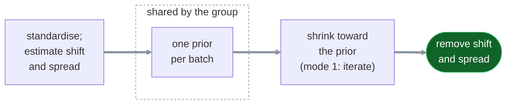
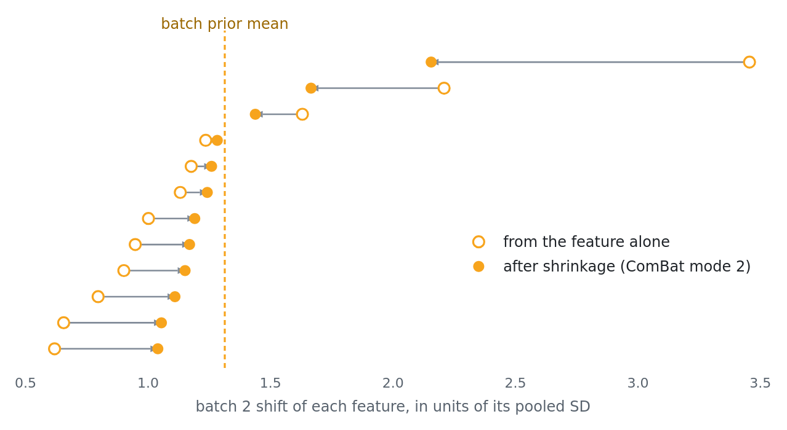
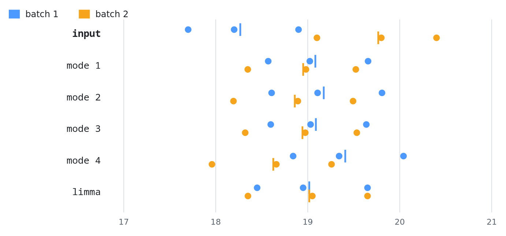

# ComBat

A batch of three samples gives a noisy estimate of how far one protein is shifted in that batch. ComBat ([Johnson et al. 2007](References#johnson-et-al-2007); as implemented in the R package `sva`, [Leek et al. 2012](References#leek-et-al-2012)) steadies those estimates by borrowing from the other proteins in the same group: each protein's batch shift, and in modes 1 and 3 its batch scale, is pulled toward what is typical for that batch across all of them. That borrowing is empirical Bayes, and it is what separates ComBat from fitting each protein on its own, as [limma](limma) does.

HarmonizePy runs ComBat once per affiliation group (see [Pipeline](Pipeline)). Everything below happens inside one group: its features, and the samples of its batches.

## The model

For feature $`g`$ in sample $`j`$ of batch $`i`$:

```math
y_{gj} = \alpha_g + \sigma_g \left( \gamma_{gi} + \sqrt{\delta_{gi}}\, \varepsilon_{gj} \right), \qquad \varepsilon_{gj} \sim N(0, 1)
```

- $`\alpha_g`$ is the feature's overall level, the mean of its batch means weighted by the number of samples in each batch.
- $`\sigma_g`$ is its pooled spread within batches.
- $`\gamma_{gi}`$ is the location effect of batch $`i`$: a shift, in units of $`\sigma_g`$.
- $`\delta_{gi}`$ is the scale effect of batch $`i`$: a factor on the variance.

Here $`\delta_{gi}`$ is a factor on the variance, as in `sva`; Johnson et al. write the same factor as $`\delta_{gi}^2`$. There are no other terms. The batch label is the only thing the model knows about a sample (see [Batch effects](Batch-Effects#when-the-batch-is-also-the-biology)).

## How a group is corrected



<p align="center"><sub><b>Figure 1.</b> One group's fit. In mode 1 the shrink step repeats until the largest relative change is below 1e-4. The prior is the only place where features meet: each feature's own estimates are pulled toward what the other features of its group show in the same batch. That is why adding or removing a feature can move the others.</sub></p>

1. Standardise. Each value becomes $`s_{gj} = (y_{gj} - \hat\alpha_g)/\hat\sigma_g`$.
2. Estimate per feature and batch. $`\hat\gamma_{gi}`$ is the mean of the feature's standardised values in the batch, and $`\hat\delta_{gi}`$ their variance.
3. Shrink. Each batch gets a prior from all features' estimates in that batch, and each feature's estimates move toward it. How far depends on how much data the feature has in the batch and how much the features disagree.
4. Remove. The shrunk effects $`\gamma^*`$ and $`\delta^*`$ are taken out and the scale and level put back:

```math
\hat y_{gj} = \hat\sigma_g \, \frac{s_{gj} - \gamma^*_{gi}}{\sqrt{\delta^*_{gi}}} + \hat\alpha_g
```

Missing cells are skipped at every step: each feature's estimates use the cells it has, and a missing cell stays missing.

The pooled spread $`\hat\sigma_g^2`$ follows `sva::ComBat`. In a group with no missing cell it is the mean of the squared residuals from the batch means: their sum over the $`N`$ samples, divided by $`N`$. In a group with any missing cell, every feature uses the sample variance of its residuals instead, their sum divided by the feature's own number of values minus one. A single missing cell therefore changes how every feature of its group is scaled: a complete feature's variance grows by the factor $`N/(N-1)`$.

## Parametric and non-parametric priors

Modes 1 and 2 use the parametric prior. In each batch the location effects are given a normal prior, and in mode 1 the scale effects an inverse-gamma prior, with their parameters estimated from the features by the method of moments of Johnson et al. Mode 2 has no scale to estimate, and its shrunk location has a closed form. Mode 1 finds each feature's location and scale by iterating two update formulas until the largest relative change in the batch is below $`10^{-4}`$, the threshold `sva` uses. The relative change is measured against the absolute value of the previous estimate, where `sva` divides by the signed previous location, so a feature whose location estimate is negative does not enter `sva`'s test; the two can stop at different iterations, and on the test fixtures, mode 1 agrees with `sva` within the tests' tolerances (see [R compatibility](R-Compatibility#tolerances)).

For batch $`i`$ the prior's parameters are the method-of-moments estimates over the $`G`$ features of the group: $`\bar\gamma_i`$ and $`\tau_i^2`$ are the mean and sample variance of the $`\hat\gamma_{gi}`$, and with $`m_i`$ and $`s_i^2`$ the mean and sample variance of the $`\hat\delta_{gi}`$, the inverse-gamma prior has

```math
a_i = \frac{2 s_i^2 + m_i^2}{s_i^2}, \qquad b_i = \frac{m_i s_i^2 + m_i^3}{s_i^2}
```

A feature with $`n`$ values in the batch then moves toward the prior mean by

```math
\gamma^*_{gi} = \frac{n \tau_i^2 \hat\gamma_{gi} + \delta^*_{gi} \bar\gamma_i}{n \tau_i^2 + \delta^*_{gi}}
```

so a feature with few values, or a batch whose features agree closely (small $`\tau_i^2`$), is pulled furthest. Mode 1 alternates this with the matching update of $`\delta^*_{gi}`$; mode 2 fixes $`\delta^* = 1`$ and $`n = 1`$.

<p align="center">
  <picture>
    <source media="(prefers-color-scheme: dark)" srcset="assets/shrinkage-dark.png">
    <source media="(prefers-color-scheme: light)" srcset="assets/shrinkage-light.png">
    
  </picture>
</p>
<p align="center"><sub><b>Figure 2.</b> Shrinkage on twelve simulated features with two batches of four. Each arrow runs from a feature's own estimate of its batch 2 shift to its value after ComBat mode 2. The furthest estimates move the most, toward the prior mean shared by all twelve; the drawn values reproduce <code>combat()</code> to 1e-9.</sub></p>

Modes 3 and 4 use no distribution for the effects. A feature's estimate in a batch is the average of the other features' estimates, each weighted by how well it explains the feature's observed values under a normal likelihood. The average is computed exactly over the other features in the group; there is no sampling, so the same input always gives the same output. Its cost grows with the square of the number of features in a group.

## The four modes

`combat_mode` picks a pair of switches, the same pairs HarmonizR passes to `sva::ComBat`:

| Mode | Prior          | Scale corrected | `par_prior` | `mean_only` | `needed_values` |
| ---- | -------------- | --------------- | ----------- | ----------- | --------------- |
| 1    | parametric     | yes             | `True`      | `False`     | 2               |
| 2    | parametric     | no              | `True`      | `True`      | 1               |
| 3    | non-parametric | yes             | `False`     | `False`     | 2               |
| 4    | non-parametric | no              | `False`     | `True`      | 1               |

- Mode 1 is the default.
- Modes 2 and 4 correct the location only, so each batch keeps the spread it had. They need only one value per batch, since no variance is estimated in a batch; the default `needed_values` follows.
- Any batch with a single sample makes ComBat correct the whole group in location-only mode, whatever the mode, because one sample has no spread. The run log says so. Inside `harmonize()` this needs `needed_values=1`: with the default of 2, a one-sample batch never counts for any feature, and its sample comes out empty.

The modes on protein P2 of the [Quick start](Quick-Start) example (batches 1 and 2; batch 3 is outside its group):

```text
           s1     s2     s3     s4     s5     s6
input   18.20  18.90  17.70  19.80  20.40  19.10
mode 1  19.02  19.66  18.57  18.98  19.52  18.35
mode 2  19.11  19.81  18.61  18.89  19.49  18.19
mode 3  19.03  19.64  18.60  18.97  19.53  18.32
mode 4  19.34  20.04  18.84  18.66  19.26  17.96
```

<p align="center">
  <picture>
    <source media="(prefers-color-scheme: dark)" srcset="assets/combat-modes-dark.png">
    <source media="(prefers-color-scheme: light)" srcset="assets/combat-modes-light.png">
    
  </picture>
</p>
<p align="center"><sub><b>Figure 3.</b> Every engine closes most of the 1.5 gap between P2's batch means; the ComBat modes go slightly past it, leaving batch 1 above batch 2 by 0.13 (mode 1) to 0.78 (mode 4). Modes 2 and 4 move each batch as a whole, so the spacing of the dots inside a batch is exactly the input's; modes 1 and 3 also rescale it, and limma puts the two means at the same value.</sub></p>

All four close most of the gap of about 1.5 between the batches, and end with batch 1 above batch 2 by 0.13, 0.31, 0.15 and 0.78. ComBat does not set each protein's batch means equal: it estimates each protein's batch shift partly from the other proteins in its group, so what remains can fall on either side. Modes 2 and 4 keep the input's differences within each batch exactly (0.7 and 1.2 below the highest sample in batch 1); modes 1 and 3 also rescale them.

## Features ComBat leaves raw

Some features cannot be estimated, and fitting them would also move the prior for every other feature. ComBat sets them aside, fits the rest as if they were absent, and returns them with their measured values. Their correction would come from the variance floor, not from their data, and I would rather return a measured value than one made up that way:

- a feature whose pooled variance is below $`10^{-12}`$, such as one constant within every batch, in every mode;
- in mode 1, a feature whose variance in some batch with two or more values is below $`10^{-12}`$ of its pooled variance, such as one constant within a batch (modes 2 to 4 keep such a feature in the fit and correct it);
- a feature with values in one batch only;
- with `ref_batch`, a feature with no value in the reference batch.

When fewer than two features remain, there is no prior to form, and the group is returned as given. The [correction report](Correction-Report) names each case that `harmonize()` can meet; the reference-batch case arises only in direct calls. `sva::ComBat` leaves out rows with zero variance in a batch too, with a narrower test; the differences are on [R compatibility](R-Compatibility).

## A feature missing a whole batch

Inside a group, every feature has values in every batch, so this case does not arise in `harmonize()`. Called directly, `combat()` fits a feature that has no value in one batch on the batches it has. `sva::ComBat` stops with a singular-matrix error on the same input.

## Reference batch

`combat()` and `adjust_combat()` take `ref_batch`: that batch is left unchanged, and the others are adjusted toward it, with the level and pooled spread taken from the reference batch alone. HarmonizePy requires at least two samples in the reference batch; `sva` only checks that the label exists. `harmonize()` does not take `ref_batch`, because a group need not contain any given batch.

## Related pages

- [Choosing an engine](Algorithms): ComBat against limma, and mode against mode.
- [Correction report](Correction-Report): the statuses for features set aside.
- [API reference](API-Reference#combat): the `combat()` and `adjust_combat()` signatures.
