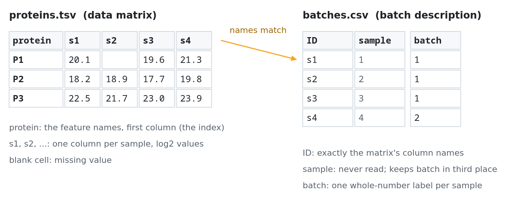

# Input format

A run takes two tables: the data matrix, with one row per feature and one column per sample, and the batch description, which gives each sample its batch. Both can be files or pandas DataFrames.

<p align="center">
  <picture>
    <source media="(prefers-color-scheme: dark)" srcset="assets/input-anatomy-dark.png">
    <source media="(prefers-color-scheme: light)" srcset="assets/input-anatomy-light.png">
    
  </picture>
</p>
<p align="center"><sub><b>Figure 1.</b> The two tables meet on the sample name. Every column of the matrix must appear exactly once in the description's <code>ID</code> column; <code>sample</code> is never read, and <code>batch</code> gives each sample its batch.</sub></p>


## Data matrix

Features (proteins, peptides, metabolites, genes) are rows; samples are columns. The first column of a file holds the feature names, and the rest are samples:

```text
protein	s1	s2	s3	s4	s5	s6
P1	20.1		19.6	21.3	20.9	21.8
P2	18.2	18.9	17.7	19.8	20.4	19.1
```

The reader is chosen by the file's extension:

| Extension         | Read as                        |
| ----------------- | ------------------------------ |
| `.csv`            | comma-separated                |
| `.parquet`, `.pq` | Parquet (needs the `io` extra) |
| any other         | tab-separated                  |

- A Parquet file must hold the feature names as its index. A feature-name column that is not the index is read as a sample and refused as text.
- A DataFrame must have the feature names as its index and the samples as its columns. Read a file with `pd.read_csv("data.tsv", sep="\t", index_col=0)`; without `index_col=0` the name column becomes a text column and the run is refused.
- Missing values are empty cells or pandas' usual markers, among them `NA`, `NaN`, `nan`, `null`, `N/A`, `#N/A`, `None` and `<NA>`. A `-` is not a missing marker: it makes its column text, and the run is refused.
- Every sample column must be numeric. A text cell anywhere in a column fails the whole column, with `data contains non-numeric columns: [...]`. R's HarmonizR turns such a cell into a missing value without a word; I refuse it, because silent coercion can hide a data preparation error.
- Sample names must be unique, in a file header as in a DataFrame.
- Infinite values are refused, naming the first features that hold them (see [Scale](#scale)). With ComBat, so are values of magnitude 1e150 or more, whose squares overflow its variance sums; log-scale data are far below that.
- A row with no values at all is kept and comes out empty, with the status `missing_no_usable_batch`.

### Repeated features

A feature name can appear more than once only with identical values in every cell, missing cells included. The first row is kept and the others are removed, and the log says so:

```text
INFO [harmonizepy] Removed 1 repeated feature(s) with identical values: P2
```

I remove a repeat only when nothing is lost, and log every removal rather than collapsing rows silently. The same name with different values is refused: `duplicate feature names with different values: 'P2' appears more than once. Each feature name must have one set of values.` Two different names with identical values are both kept, since two proteins can quantify to the same numbers. The report's `repeats_removed` column counts the removed rows for each feature (see [Correction report](Correction-Report)).

### Scale

> [!IMPORTANT]
> Both engines treat the location part of a batch effect as a shift added to the values (see [Batch effects](Batch-Effects#why-the-log-scale-matters)), so the values should be log-transformed, usually log2. HarmonizePy does not transform them. Use `log2(x + 1)` for intensities that contain zeros and `log2(x)` otherwise. For proportions such as methylation beta values, correct the M-values, `log2(beta / (1 - beta))`, and convert back for reporting ([Du et al. 2010](References#du-et-al-2010)).

A check warns with `harmonizepy.InputScaleWarning` when the values look untransformed:

- every value is non-negative and the 95th percentile is above 100, as for raw intensities and counts; or
- every value lies between 0 and 1, with more than two distinct values, as for proportions.

The check is a heuristic. It does not catch percentages from 0 to 100, or raw data that contain a single negative value. `harmonize()` and the command line run it; the engines called directly do not. Silence it in Python with `warnings.filterwarnings("ignore", category=harmonizepy.InputScaleWarning)`.

## Batch description

One row per sample. HarmonizePy reads two of its columns: the sample IDs and the batch labels.

```text
ID,sample,batch
s1,1,1
s2,2,1
s3,3,1
s4,4,2
s5,5,2
s6,6,2
```

- The file is always read as comma-separated, whatever its extension. A tab-separated description is read as one column and refused.
- It must have at least three columns. The IDs come from the column named `ID`, or else the first column; the labels from the column named `batch`, or else the third. Names are case-sensitive. The `sample` column, kept for compatibility with HarmonizR, is never read. It still matters by position: when no column is named `batch`, the batch labels are read from the third column.
- The IDs must be exactly the matrix's column names, each listed once. A sample missing from either side is refused, and the message lists the names that do not match.
- Batch labels must be whole numbers: `1`, `1.0` and `"1"` are accepted; text, blanks and fractions such as `1.5` are refused, naming the column.
- Batches can differ in size. A batch of one sample is accepted; ComBat then corrects its groups for location only (see [ComBat](ComBat#the-four-modes)).
- With a single batch there is nothing to correct against. Every feature with at least `needed_values` values keeps them as measured; the others come out empty.

## Errors

Validation runs before any correction. On the command line each of these errors is one line starting `ERROR:`, with exit status 1; a missing file is a usage error with status 2 (see [CLI reference](CLI-Reference#exit-status)).

| Message starts with                                    | Cause                       |
| ------------------------------------------------------ | --------------------------- |
| `data contains non-numeric columns`                    | text in a sample column     |
| `data contains duplicate sample names`                 | repeated column name        |
| `duplicate feature names with different values`        | same name, different values |
| `data contains infinite values`                        | `inf` or `-inf` in a cell   |
| `data contains values of magnitude 1e150 or more`      | ComBat with huge values     |
| `data must have at least 2 sample columns`             | one sample                  |
| `description must have at least 3 columns`             | too few columns             |
| `the ID column cannot be found`                        | first column is the batch   |
| `the batch column cannot be found`                     | third column is the ID      |
| `Sample IDs in description do not match data columns`  | ID sets differ              |
| `sample IDs listed more than once in the description`  | repeated ID                 |
| `batch labels in column 'batch' must be whole numbers` | text, blank or fraction     |

## Related pages

- [Missing values](Missing-Values): what happens to the gaps in the matrix.
- [CLI reference](CLI-Reference): output formats and the default output path.
- [API reference](API-Reference): passing DataFrames to `harmonize()`.
