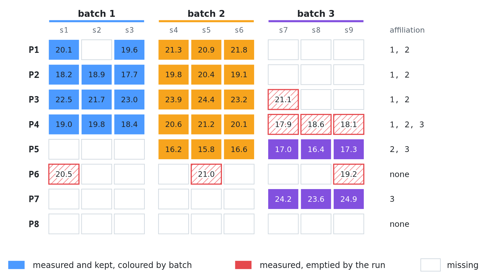

# Missing values

In a label-free proteomics matrix, an empty cell mostly does not mean the protein was absent from the sample ([Lazar et al. 2016](References#lazar-et-al-2016)). Most often it means the instrument did not report it: the protein was below the detection limit in that run, or, in data-dependent acquisition, its peptides were not picked for fragmentation that time. Low-abundance proteins come and go between runs, and a batch with lower sensitivity can lose a protein entirely.

So a matrix holds two kinds of gap, and HarmonizePy treats them differently:

- a scattered gap, one or a few cells missing in a batch where the feature was otherwise measured;
- a structural gap, in this wiki's usage a feature missing from a whole batch, or with too few values there (fewer than `needed_values`) to estimate anything.

The first kind is mostly chance; the second often follows abundance, since a protein near the detection limit drops out of the less sensitive runs, so it is missing not at random.

## Why structural gaps break plain ComBat

ComBat and limma estimate each feature's effect in each batch from the values it has there. A feature with no value in batch 3 has no batch 3 effect to estimate. `sva::ComBat` stops on such a feature with a singular-matrix error, so `sva::ComBat` cannot correct a matrix with even one protein missing from a whole batch in one piece. Scattered gaps are fine for both engines: each feature is fitted on its observed cells.

## What HarmonizePy does instead

Following HarmonizR ([Voss et al. 2022](References#voss-et-al-2022)), it corrects each feature only over the batches where the feature has enough values, and corrects it together with the other features that share exactly those batches. The number of values a feature needs in a batch is `needed_values`: 2 by default for ComBat modes 1 and 3 and for limma, 1 for ComBat modes 2 and 4. The set of batches where a feature reaches it is the feature's affiliation, and features with the same affiliation form one group, corrected as one smaller matrix (see [Pipeline](Pipeline)).

The [Quick start](Quick-Start) example has eight proteins over three batches of three samples, chosen so that each shows one case:

  <picture>
    <source media="(prefers-color-scheme: dark)" srcset="assets/missing-matrix-dark.png">
    <source media="(prefers-color-scheme: light)" srcset="assets/missing-matrix-light.png">
    
  </picture>

<b>Figure 1.</b> The red cells are measured values that do not reach the output. Each one sits in a batch its protein is not corrected over: below <code>needed_values</code> there (P3, P6), or cut by unique removal (P4, whose affiliation on the right, 1, 2, 3, becomes 1, 2).

With `needed_values` 2:

| Protein | Gap                                      | Affiliation |
| ------- | ---------------------------------------- | ----------- |
| P1      | one cell in batch 1, absent from batch 3 | 1, 2        |
| P2      | absent from batch 3                      | 1, 2        |
| P3      | one value in batch 3                     | 1, 2        |
| P4      | none                                     | 1, 2, 3     |
| P5      | absent from batch 1                      | 2, 3        |
| P6      | one value per batch                      | none        |
| P7      | batch 3 only                             | 3           |
| P8      | empty                                    | none        |

- P1's missing cell in batch 1 is a scattered gap. Batch 1 still has two values, so it counts, and the cell stays empty in the output.
- P3 has a value in batch 3, but one is below `needed_values`, so batch 3 is outside its affiliation. That value does not reach the output.
- P6 has three values and no batch with two. It comes out empty.

## Missing values are never filled

> [!NOTE]
> HarmonizePy does not impute. Every number in the output is a measured value, either corrected or left as measured; none is invented to fill a gap.

An empty cell in the input is empty in the output, and some measured values become empty too:

- values in batches outside the feature's affiliation, such as P3's value in batch 3;
- values in batches that [unique removal](Unique-Removal) cut from the feature, such as P4's batch 3 in the default run;
- all values of a feature with no batch that reaches `needed_values`, such as P6.

The [correction report](Correction-Report) shows this per feature: `batches_used` lists the batches a corrected feature kept, so its values in any other batch are empty, `cropped` marks the features unique removal moved, and `missing_no_usable_batch` marks the rows that are empty throughout.

## Zeros and infinite values

A zero is a measured value and is never read as missing. Like any value, it enters its feature's batch mean and spread: if P1's value in `s1` were 0 instead of 20.1, its corrected `s3` would be 24.15 instead of 20.22. On a log scale, a zero intensity becomes minus infinity, and HarmonizePy refuses infinite values with an error that names the feature. Replace them with an empty cell, or use `log2(x + 1)` when the data contain zeros (see [Input format](Input-Format#scale)).

## Related pages

- [Pipeline](Pipeline): how affiliations become groups, followed through the same eight proteins.
- [Unique removal](Unique-Removal): how a feature whose affiliation nobody shares can still be corrected.
- [Correction report](Correction-Report): what happened to each feature, and why.
