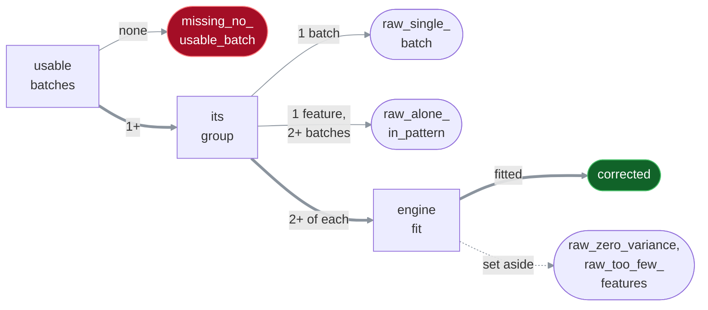
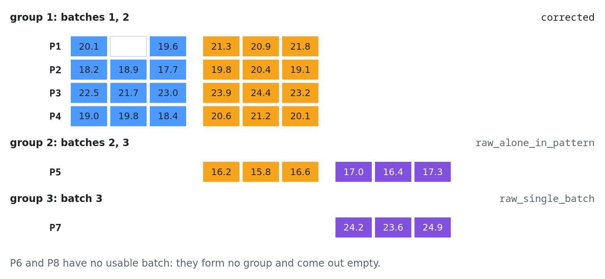

# Pipeline

Which batches a protein was measured in decides which proteins it is corrected with. `harmonize()` groups every feature by that question, corrects each set of features that share an answer as one smaller matrix, and puts the pieces back in the input's order. The approach is HarmonizR's ([Voss et al. 2022](References#voss-et-al-2022)). This page follows the eight proteins of the [Quick start](Quick-Start) example through it.

## One feature's way through



<p align="center"><sub><b>Figure 1.</b> The status each feature ends with in the <a href="Correction-Report">correction report</a>. The thick line is the path to correction. Only green is corrected; the plain outcomes keep the feature's measured values inside its group's batches, and red empties the row. Unique removal, on by default, runs before groups are formed. A group in one batch is <code>raw_single_batch</code> whatever its size, so P7 ends there.</sub></p>

## Affiliations

For each feature, HarmonizePy finds the batches where it has at least `needed_values` measured values ([Missing values](Missing-Values#what-harmonizepy-does-instead) gives the defaults). That set is the feature's affiliation. Features with the same affiliation form a group.

With the default settings, the example proteins have these affiliations (the matrix is drawn on [Missing values](Missing-Values)):

| Protein    | Affiliation | After unique removal |
| ---------- | ----------- | -------------------- |
| P1, P2, P3 | 1, 2        | 1, 2                 |
| P4         | 1, 2, 3     | 1, 2                 |
| P5         | 2, 3        | 2, 3                 |
| P6, P8     | none        | none                 |
| P7         | 3           | 3                    |

P4 is the only protein measured in all three batches. A group of one feature cannot be corrected (ComBat has no other feature to estimate its prior from, and limma would remove the feature's own batch differences, real ones included), so [unique removal](Unique-Removal) moves P4 into the group of P1 to P3 and gives up its batch 3 values. P5's affiliation is also its own, but no shared affiliation fits inside it, so it stays alone.

The groups, then, are {P1, P2, P3, P4} over batches 1 and 2, {P5} over batches 2 and 3, and {P7} over batch 3. The dry run reports the same count:

```text
  Sub-matrices:    3  (unique affiliation groups)
```

## Correcting each group

<p align="center">
  <picture>
    <source media="(prefers-color-scheme: dark)" srcset="assets/pipeline-groups-dark.png">
    <source media="(prefers-color-scheme: light)" srcset="assets/pipeline-groups-light.png">
    
  </picture>
</p>
<p align="center"><sub><b>Figure 2.</b> The three groups the default run forms, each a smaller matrix with only its own batches. Only group 1 has two or more features over two or more batches, so only it reaches the engine.</sub></p>

Each group becomes a matrix of its features and the samples of its batches, and the engine corrects it alone. Gaps inside the group, such as P1's missing cell in batch 1, go into the engine as gaps: each feature is fitted on the cells it has, and the gap stays empty in the output.

A group is fitted only when it has at least two features and at least two batches. The other groups keep their measured values:

- {P7} spans one batch, so there is nothing to correct it against: `raw_single_batch`.
- {P5} has one feature: `raw_alone_in_pattern`.

Inside a fitted group, ComBat can still set a feature aside, for example one whose variance is zero; those statuses are explained on [Correction report](Correction-Report).

HarmonizR drops these features. I keep them with their measured values instead: no value is corrected where its batch effect cannot be estimated, and the report names every such feature, so it is always visible which rows were not corrected.

## The result

`harmonize()` returns the matrix with the input's features and sample columns, in the input's order:

```text
            s1     s2     s3     s4     s5     s6    s7    s8    s9
protein
P1       20.67    NaN  20.22  20.69  20.33  21.14   NaN   NaN   NaN
P2       19.02  19.66  18.57  18.98  19.52  18.35   NaN   NaN   NaN
P3       23.30  22.58  23.75  23.09  23.54  22.45   NaN   NaN   NaN
P4       19.84  20.56  19.30  19.77  20.32  19.32   NaN   NaN   NaN
P5         NaN    NaN    NaN  16.20  15.80  16.60  17.0  16.4  17.3
P6         NaN    NaN    NaN    NaN    NaN    NaN   NaN   NaN   NaN
P7         NaN    NaN    NaN    NaN    NaN    NaN  24.2  23.6  24.9
P8         NaN    NaN    NaN    NaN    NaN    NaN   NaN   NaN   NaN
```

> [!IMPORTANT]
> The output is not the input with values changed. Measured values outside a feature's group come out empty.

Three things in this output are easy to miss:

- It is not the input with values changed. P3's value in `s7` and P4's values in `s7` to `s9` were measured and are now empty, because those batches are outside the group each protein was corrected in. P6 had three values and is empty.
- A feature's correction depends on the rest of its group. Without unique removal, P4 stays raw and the group is P1 to P3 only; P1's value in `s1` is then 20.70 instead of 20.67. Filling P1's one missing cell would change P2 to P4 too, because ComBat uses one variance rule for a group that has any gap and another for a group that has none.
- Only one kind of row is removed: a feature repeated with the same name and the same values appears once (see [Input format](Input-Format#repeated-features)).

## Groups are corrected to their own level

Each group is corrected toward the mean of its own batches. A feature corrected over batches 1 and 2 ends near its batch 1 and 2 average; a feature corrected over batches 1, 2 and 3 ends near its average over all three. When batch 3 reads higher or lower than the others, two features with the same true level can come out at different levels partly because they were measured in different batches. Comparisons within a feature, between samples, are what the correction is for; comparisons of levels between features with different affiliations carry this offset (see [Limits](Limits)).

## Many batches: sorting and blocking

With many batches and much missing data, features scatter over many small groups. `block` groups neighbouring batches so that affiliations are formed over fewer, larger units, and `sort` decides which batches are neighbours. Blocking trades measured values for larger groups, and sorting decides which batches share a block; they are explained on [Sorting and blocking](Sorting-and-Blocking).

## Related pages

- [Unique removal](Unique-Removal): the rule that moved P4, and when it finds nothing.
- [Correction report](Correction-Report): reading the status of every feature after a run.
- [ComBat](ComBat) and [limma](limma): what happens inside one group.
