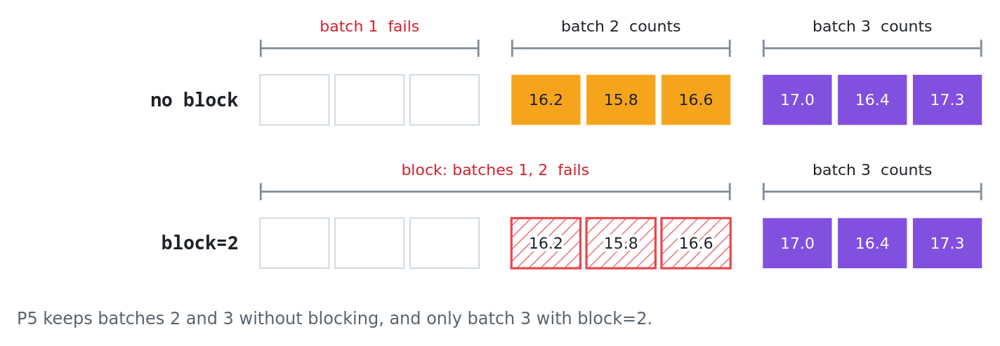
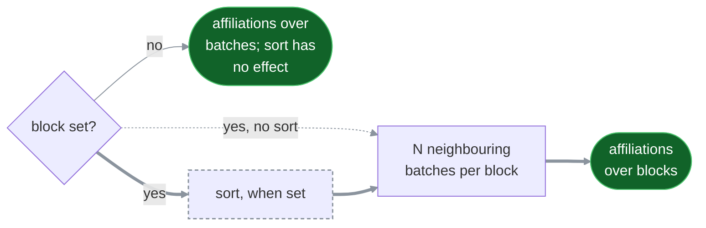

# Sorting and blocking

With twenty batches and patchy coverage, proteins scatter over hundreds of small affiliation groups, many of them too small to correct well. Blocking makes the unit of affiliation a block of neighbouring batches instead of a single batch, so there are fewer possible patterns and larger groups. Sorting decides which batches are neighbours. Both come from HarmonizR ([Schlumbohm et al. 2025](References#schlumbohm-et-al-2025)), and both are off by default.

## Blocking

`block=N` (`--block N`) takes the batches in their order, after sorting if `sort` is set, and puts every N of them in one block. When the number of batches is not a multiple of N, the last block is smaller. N must be at least 2 and smaller than the number of batches, since a single block holding every batch would leave nothing to correct.

A block counts for a feature only when every batch inside it has at least `needed_values` values of the feature. Affiliations, groups and unique removal then work on blocks. The engine still corrects each original batch inside a group: blocking changes who is grouped with whom, not what a batch is.

The cost is measured values. A feature missing from one batch of a block loses the whole block. In the [Quick start](Quick-Start) example with `block=2`, batches 1 and 2 form block 1 and batch 3 forms block 2. P5 is measured in batches 2 and 3; block 1 fails for it because batch 1 is empty, so P5 keeps only batch 3:

  <picture>
    <source media="(prefers-color-scheme: dark)" srcset="assets/blocking-dark.png">
    <source media="(prefers-color-scheme: light)" srcset="assets/blocking-light.png">
    
  </picture>

<b>Figure 1.</b> A block counts only when every batch in it has enough values. Batch 1 is empty for P5, so the block of batches 1 and 2 fails, and P5's three measured values in batch 2 go with it.

| Run       | P5 status              | P5 values kept |
| --------- | ---------------------- | -------------- |
| no block  | `raw_alone_in_pattern` | s4 to s9       |
| `block=2` | `raw_single_batch`     | s7 to s9       |

Whether the larger groups are worth the lost values depends on the data, and no measurement here gives a block size that suits most data. The dry run's sub-matrix count and the report's status counts, with and without blocking, show the trade on a given matrix.

## How the two options combine

<b>Figure 2.</b> Sorting matters only on the blocked path, where it decides which batches share a block. The dashed box runs only when <code>sort</code> is given.

## Sorting

`sort` (`--sort`) reorders the batches before blocking so that batches with similar coverage sit next to each other, and so more often share a block. Each strategy works from which features are present in each batch, where present means at least `needed_values` values:

| Strategy    | Order                                         |
| ----------- | --------------------------------------------- |
| `sparsity`  | most present features first                   |
| `jaccard`   | nearest-neighbour chain on Jaccard similarity |
| `seriation` | score on the first principal component        |

- `jaccard`: the similarity of two batches is the number of features present in both over the number present in either. The chain starts at the batch most similar to all the others and moves each time to the most similar batch not yet placed.
- `seriation`: batches are scored on the first principal component of their presence vectors, centred per feature and not scaled.

Sorting changes the result only together with blocking. Without `block`, every sort gives exactly the same output as no sort, because affiliations over single batches do not depend on their order. The output keeps the input's column order either way.

In the example, the presence counts are 4, 5 and 3 for batches 1, 2 and 3, so `sort="sparsity"` orders them 2, 1, 3. With `block=2` the blocks are {2, 1} and {3}, the same grouping as without sorting, so the output does not change.

All three strategies can order batches differently from HarmonizR, whose rules for each differ (see [R compatibility](R-Compatibility)). No measurement here shows one strategy correcting better than another.

## Related pages

- [Pipeline](Pipeline): affiliations and groups, which blocking changes.
- [Unique removal](Unique-Removal): with blocks, it crops blocks.
- [CLI reference](CLI-Reference): the `--sort`, `--block` and `--dry-run` flags.
