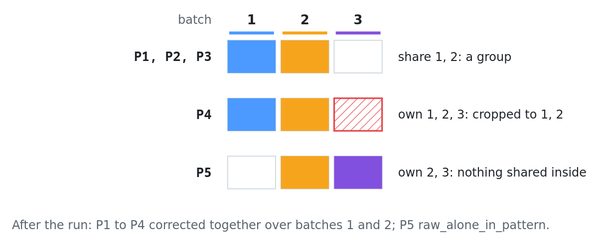

# Unique removal

A protein measured in a set of batches that no other protein shares would form a group of one, and a group of one cannot be corrected. Unique removal gives such a protein a smaller set of batches that other proteins do share, when one exists, so it can be corrected with them, at the cost of its values in the batches it gives up. HarmonizR introduced the step ([Schlumbohm et al. 2025](References#schlumbohm-et-al-2025)). It is on by default (`unique_removal=True`, or `--no-unique-removal` to switch it off).

## The rule

For each feature whose affiliation is its own, HarmonizePy looks at the affiliations of the other features and picks the longest one that is a proper subset of the feature's affiliation. The feature takes that affiliation, joins its group, and its values in the dropped batches come out empty.

- The target may be held by a single other feature. That feature then keeps its affiliation, and the two form a group.
- Features are taken longest affiliation first, and among equally long targets the one more features hold wins, then the smallest. The result does not depend on the order of the rows.
- An affiliation that spans a single batch is never a target: its group would be left raw, so the move would only empty the feature's other values.
- A feature with no target keeps its affiliation, and stays a group of one with its measured values.
- A feature with an empty affiliation is left alone; it comes out empty either way.

## On the example

In the [Quick start](Quick-Start) example, P4 is measured in batches 1, 2 and 3, and no other protein is. (1, 2), held by P1 to P3, is the longest affiliation inside (1, 2, 3), so P4 moves:

```text
INFO [harmonizepy] Unique removal moved 1 feature(s) into a shared pattern (12.5%)
```

The log calls an affiliation a pattern.

<p align="center">
  <picture>
    <source media="(prefers-color-scheme: dark)" srcset="assets/unique-removal-dark.png">
    <source media="(prefers-color-scheme: light)" srcset="assets/unique-removal-light.png">
    
  </picture>
</p>
<p align="center"><sub><b>Figure 1.</b> P4's affiliation (1, 2, 3) is its own, and (1, 2) is shared by three proteins and fits inside it, so P4 gives up batch 3 and joins them. P5's affiliation (2, 3) has only one-batch affiliations inside it, which are never targets, so P5 stays alone.</sub></p>

| Run                    | P4 status              | P4 in s7 to s9   | Group of P1 to P3 |
| ---------------------- | ---------------------- | ---------------- | ----------------- |
| default                | `corrected`, cropped   | empty            | 4 features        |
| `unique_removal=False` | `raw_alone_in_pattern` | 17.9, 18.6, 18.1 | 3 features        |

- With unique removal on, P4's batch 3 values are lost and its batches 1 and 2 are corrected. With it off, P4 keeps all nine values uncorrected.
- The choice also changes the other features of the group: P1's corrected value in `s1` is 20.67 with P4 in the group and 20.70 without it.

P5, measured in batches 2 and 3, has only (2) and (3) inside its affiliation, and an affiliation of one batch is never a target. It stays alone and raw under both settings.

The report marks a moved feature with `cropped` set to true, and its `batches_used` lists the batches it kept (see [Correction report](Correction-Report)).

## Choosing the setting

The setting is a trade between correcting more features and keeping more measured values:

- On: a feature with an affiliation of its own, and another feature's affiliation of two or more batches inside it, is corrected over fewer batches, and its values in the cropped batches disappear from the output.
- Off: such a feature keeps its measured values in the batches of its affiliation, uncorrected, with its batch effect in place.

Neither is right for every study.

> [!TIP]
> The report shows what the choice costs: in a run with unique removal, the `cropped` rows are the features that gave up batches. Turning it off makes each of them `raw_alone_in_pattern`, next to the features it could not move. On the example that is 1 cropped feature (P4), and 2 `raw_alone_in_pattern` features without it (P4 and P5).

## Difference from HarmonizR

HarmonizR's `ur` option takes the same targets, with three differences: it walks the features in row order and takes the first of equally long targets, it empties the affiliation of a feature with no target, so that feature comes out empty, and it accepts a target of one batch. HarmonizePy's order makes the groups independent of the row order, and a feature with no target keeps its measured values (see [R compatibility](R-Compatibility)).

## Related pages

- [Pipeline](Pipeline): where unique removal sits between affiliations and groups.
- [Sorting and blocking](Sorting-and-Blocking): with blocking, affiliations are over blocks, and unique removal crops blocks instead of batches.
