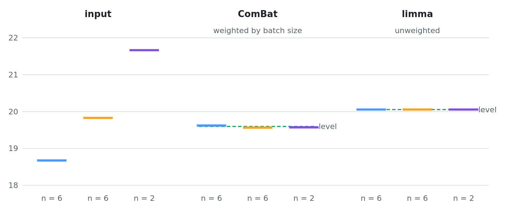

# limma

limma's `removeBatchEffect` (in the `limma` package, [Ritchie et al. 2015](References#ritchie-et-al-2015)) fits each feature on its own: a linear model with an intercept and one sum-to-zero column per batch, solved by least squares, with the fitted batch part then subtracted and the intercept kept. There is no prior and no borrowing between features, and the spread of a batch is never changed. HarmonizePy's `remove_batch_effect()` is a NumPy version of it, and `algorithm="limma"` runs it on every affiliation group.

## The model

For feature $`g`$ in sample $`j`$, with $`I`$ batches:

```math
y_{gj} = \beta_{g0} + \sum_{k=1}^{I-1} \beta_{gk}\, x_{jk} + \varepsilon_{gj}
```

The batch columns $`x_{jk}`$ are sum-to-zero contrasts, as R's `contr.sum` builds them: 1 for samples of batch $`k`$, -1 for samples of the last batch, 0 otherwise. The correction subtracts the fitted batch part and keeps the intercept:

```math
\tilde y_{gj} = y_{gj} - \sum_{k=1}^{I-1} \hat\beta_{gk}\, x_{jk}
```

With these contrasts the intercept is the unweighted mean of the batch means, so after correction every batch mean of the feature equals that value, whatever the batch sizes. ComBat's level is weighted by batch size instead (see [ComBat](ComBat#the-model)), so the two engines place a feature at different levels when batches differ in size.

<p align="center">
  <picture>
    <source media="(prefers-color-scheme: dark)" srcset="assets/levels-dark.png">
    <source media="(prefers-color-scheme: light)" srcset="assets/levels-light.png">
    
  </picture>
</p>
<p align="center"><sub><b>Figure 1.</b> One feature of a simulated ten-feature matrix, in batches of 6, 6 and 2 samples. After correction its batch means meet at the dashed line: for ComBat near the mean weighted by batch size, so the small batch counts less, and for limma exactly at the plain mean of the three batch means.</sub></p>

## On the example

Batch means of two proteins from the [Quick start](Quick-Start) example, over batches 1 and 2 (their group):

```text
         input              limma             ComBat mode 1
       batch 1  batch 2   batch 1  batch 2   batch 1  batch 2
P1       19.85    21.33     20.59    20.59     20.45    20.72
P2       18.27    19.77     19.02    19.02     19.08    18.95
```

limma puts both batch means exactly at their average: P2 at 19.02, halfway between 18.27 and 19.77. ComBat does not set the means equal: it estimates each protein's shift partly from the other proteins of the group, and P2 ends with batch 1 at 19.08 and batch 2 at 18.95.

## Missing cells

Features with the same pattern of observed cells are fitted together, on the samples they have. Gaps stay gaps in the output. Inside `harmonize()` every feature has values in every batch of its group, so the full set of batch terms is always estimable.

Called directly, `remove_batch_effect()` also handles a feature missing a whole batch, by fitting contrasts over the batches it has. It keeps a feature raw when it has values in one batch only, or when it is missing a batch and has no more observed samples than observed batches, since the fit would leave nothing but the batch means. One difference from `limma::removeBatchEffect` follows: for a feature missing its first or last batch, R sets the coefficient it cannot estimate to zero and corrects the other batches with the coefficients that remain, while HarmonizePy refits the contrasts over the batches the feature has and moves them to their common mean, so the two give different values (see [R compatibility](R-Compatibility)).

## Edges worth knowing

- A batch with one sample. limma has no minimum batch size. That sample's batch term absorbs its whole deviation, so its corrected value is the intercept for every feature, and its own signal is removed. ComBat handles the same case by switching to location-only correction. Inside `harmonize()` a one-sample batch counts only with `needed_values=1`; with the default of 2 its sample comes out empty.
- One value per batch. A feature with exactly one value in each batch of its group is collapsed to one number in every cell, the mean of its values, and is still reported as `corrected`. With `needed_values` at its default of 2 for limma, this happens only when `needed_values=1` is set by hand.
- A single feature passed directly to `remove_batch_effect()` is corrected. Inside `harmonize()` a group of one feature is left raw.
- No covariates. HarmonizePy's version takes the batch labels only; there is no `design`, `covariates` or `batch2` argument as in R.

## Related pages

- [Choosing an engine](Algorithms): limma against ComBat.
- [R compatibility](R-Compatibility): the tolerances against `limma::removeBatchEffect`.
- [API reference](API-Reference#remove_batch_effect): the `remove_batch_effect()` and `adjust_limma()` signatures.
